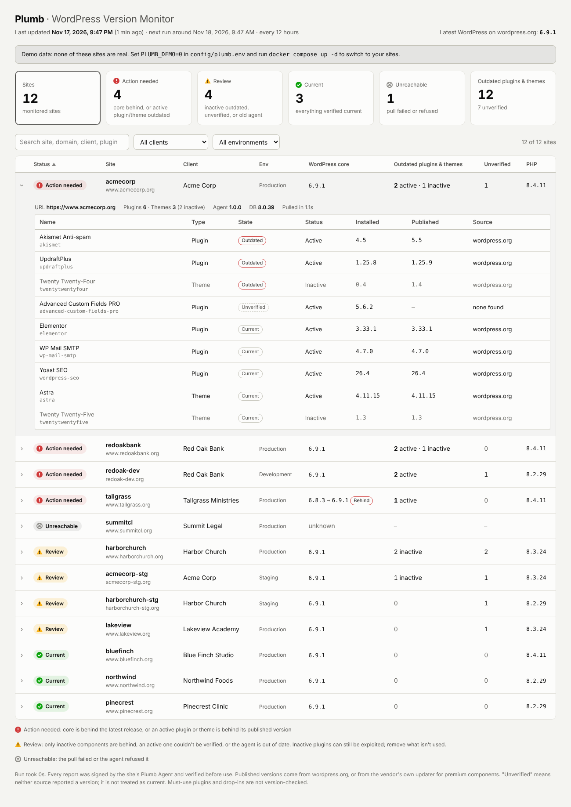
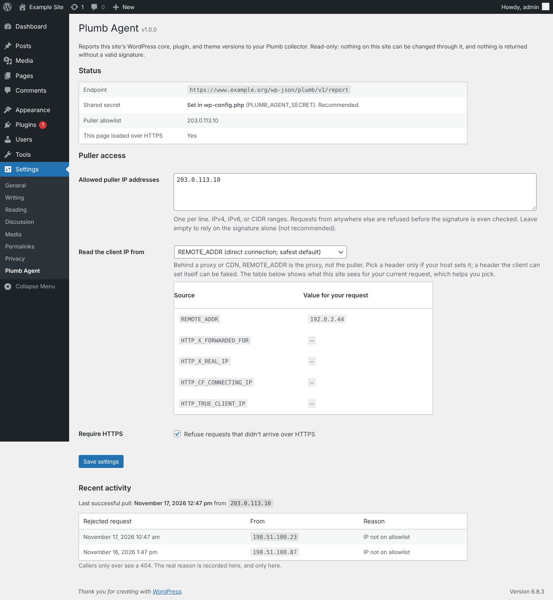

# Plumb User Guide

November 17, 2026

## What Plumb is

Plumb checks your WordPress websites twice a day and tells you which ones are running out-of-date software. Out-of-date software is the most common way websites get broken into, so this is the list worth watching.

A WordPress website is built from three kinds of parts, and each one gets updates:

- **WordPress itself** (called "core"): the engine that runs the site.
- **Plugins**: add-ons that give the site extra features, like contact forms, online stores, or search.
- **Themes**: control how the site looks.

When a company fixes a security hole in one of these parts, it releases a new version. Plumb compares the version each of your sites is running with the newest version available, and puts every site into one of four plain statuses on a single page.

**Who this guide is for.** Anyone who reads the Plumb dashboard, and anyone who manages a WordPress site that Plumb watches. You don't need a technical background. Setting up Plumb itself is covered in a separate technical guide (the README) for your Plumb administrator.

**What Plumb does not do.** It doesn't update anything, change anything, or fix anything on your sites; it only looks. It also can't tell whether a site has already been broken into. It tells you where the doors are unlocked, not whether someone already walked through one.

## Opening the dashboard

The dashboard is a web page. You need three things from your Plumb administrator:

- **The address.** It looks like `https://plumb.example.org:6443/`. The `:6443` at the end is part of the address; leave it in.
- **A username.** Usually `plumb`.
- **A password.**

**To open it:**

1. Type the address into any web browser. If you type `http://` instead of `https://` by mistake, Plumb sends you to the right address on its own.
2. Your browser shows a small sign-in box. Enter the username and password, and confirm.
3. The dashboard appears.

**If your browser warns that the connection isn't private.** Plumb can use a certificate that it creates itself, and browsers warn about those. Your Plumb administrator will tell you whether to expect this warning.

- **If they told you to expect it:** use your browser's option to continue. In Chrome and Edge, that's **Advanced**, then **Proceed**; in Safari, **Show Details**, then **visit this website**; in Firefox, **Advanced**, then **Accept the Risk and Continue**. Most browsers remember the choice.
- **If they didn't, or the warning appears for the first time on a computer you've used before:** stop and contact them before going further.

**If you see "Too many failed sign-in attempts."** Ten wrong passwords in a row lock the dashboard for 15 minutes. Wait, then try again with the correct password. On some setups, one person's mistakes can lock out everyone for those 15 minutes, so tell your Plumb administrator if it keeps happening.

**If you see "The first check of your sites is running."** Plumb has just been started and hasn't finished its first check. The page refreshes on its own every 30 seconds; the first check usually takes a minute or two.

**Keep the password to yourself.** Don't write it in emails or chat messages, and don't save it on a shared computer.

## Reading the dashboard

The page has four parts, top to bottom.

*The dashboard with sample data. The top site is opened to show its plugins and themes.*

**1. The header.** Shows when the information was last updated and when the next update is due. Plumb updates on its own every 12 hours, and right away when your administrator adds a site. A colored box may appear under the header:

- **"This data is stale"** (red): Plumb has stopped updating. Don't rely on the page until your Plumb administrator fixes it; a page that looks fine but is three days old is worse than no page.
- **"Demo data: none of these sites are real"** (gray): the page is showing sample sites while Plumb is being set up. Your real sites appear once your administrator switches it over.

**2. The summary boxes.** A row of boxes counts your sites by status: how many need action, how many need review, how many are current, and how many Plumb couldn't reach. Click any box to show only those sites. Click **Sites** to show everything again.

**3. Search and filters.** The search box finds sites by name, web address, client, or the name of a plugin or theme. Type "woocommerce" to see every site that uses WooCommerce. The **All clients** menu shows one client's sites; the **All environments** menu separates live sites from test copies.

**4. The site list.** One row per site, worst problems at the top. The columns are:

| Column | What it tells you |
| --- | --- |
| Status | The overall verdict for the site (see the next section) |
| Site | The site's short name and web address |
| Client | Which organization the site belongs to |
| Env | **Production** is the live site the public sees. **Staging** and **Development** are private test copies |
| WordPress core | The version the site runs. A red **Behind** tag means a newer version exists |
| Outdated plugins & themes | How many parts have newer versions available, split into active and inactive |
| Unverified | Parts Plumb couldn't check (explained below) |
| PHP | The programming language version the server uses. Your host or administrator manages this |

Click any row to open it and see every plugin and theme on that site. Click a column heading to sort by that column.

## What each status means and what to do

Every site gets exactly one status. Each status has a color, an icon, and a word, so you never have to rely on color alone.

| Status | What it means | What to do |
| --- | --- | --- |
| **Action needed** (red circle) | WordPress itself is out of date, or a plugin or theme the site is actively using is out of date. These are the openings attackers look for first | Ask whoever maintains the site to update it this week. For a live site that takes payments or personal information, sooner |
| **Review** (yellow triangle) | Nothing the site actively uses is behind, but something needs a look: an unused plugin or theme is out of date, Plumb couldn't confirm a version, or the Plumb Agent on the site is old | Ask the site's maintainer to look at it at their next regular check. Usually the fix is to delete unused plugins and themes |
| **Current** (green check) | Every part was checked and confirmed up to date | Nothing. Green means Plumb actually confirmed every version, not that it found no problems by accident |
| **Unreachable** (gray circle with an X) | Plumb couldn't get a report from the site this time | If it lasts more than one update (12 hours), tell your Plumb administrator. The site may be down, or a setting may have changed |

**Why unused plugins still matter.** Turning a plugin off (making it "inactive") doesn't remove its files from the server. Attackers can often reach those files directly, so an out-of-date plugin that's switched off can still be a way in. If nobody uses it, the safest fix is to delete it, not update it.

**One site often has several copies.** A client's live site and its test copy (staging) appear as separate rows. Test copies matter too: they usually contain a copy of the real site's data.

## Looking at one site

Click a site's row to open its details. Click it again to close them.

**The summary line** at the top shows the site's web address, how many plugins and themes it has, and the version of the Plumb Agent running on it.

**The parts table** lists every plugin and theme, with the problems first:

| Column | What it tells you |
| --- | --- |
| Name | The plugin or theme, with its short technical name underneath |
| Type | Plugin or theme |
| State | **Outdated** (red outline): a newer version exists. **Unverified** (dashed outline): Plumb couldn't find a published version to compare against. **Current**: up to date |
| Status | **Active** means the site is using it. **Inactive** means it's switched off but still installed. **Parent** means a theme that another theme is built on, so it's in use |
| Installed | The version on the site |
| Published | The newest version available |
| Source | Where Plumb found the newest version: **wordpress.org** (the public WordPress library) or **vendor updater** (the company that sells the plugin) |

**About "Unverified."** Some plugins are sold privately and don't appear in the public WordPress library. If the plugin's company doesn't publish its newest version where Plumb can see it, Plumb marks it Unverified rather than guessing. Unverified never counts as up to date. Whoever maintains the site should check with the plugin's company, or log in to the site and look at the Plugins page.

**Configuration warnings** appear as red tags when Plumb spots a risky setting:

- **File editor enabled**: anyone who gets into an administrator account can change the site's code from inside WordPress. Most sites should switch this off.
- **WP_DEBUG on**: a troubleshooting mode is switched on. That's fine on a test copy, but on a live site it should be off.
- **Debug output displayed**: error details may be shown to visitors, which can give an attacker useful clues.

**Notes** (yellow triangle) flag things that affect how far you can trust the results:

- **The site's own update check hasn't run in several days.** WordPress normally checks for updates by itself, but only when people visit the site, so a quiet site can fall behind. Ask the maintainer to set up a scheduled check.
- **The site reports a different web address.** The address Plumb has on file doesn't match the one the site reports, so one of them needs correcting.
- **The Plumb Agent is out of date.** The plugin that reports to Plumb needs updating.

**If the site is Unreachable,** its details show a single message explaining what went wrong. Pass that message to your Plumb administrator word for word; it tells them where to look.

## For website owners: the Plumb Agent

Plumb gets its information from a small plugin called **Plumb Agent** that sits on each website. It only reports version numbers. It can't change your site, and it answers only Plumb, which proves who it is with a secret code unique to your site.

Your Plumb administrator usually installs the Agent for you, because it goes into the site's files rather than the normal Plugins page. That also means it can't be switched off by accident. Once it's installed, you may be asked to check its settings page.

**What you'll need from your Plumb administrator:**

- The Plumb computer's **IP address**: a number like `203.0.113.10` that identifies the computer Plumb runs on.
- Confirmation that the **secret code** is set up. They normally handle this themselves.

**Checking the settings, step by step:**

1. Log in to your WordPress site as an administrator.
2. In the left-hand menu, go to **Settings**, then **Plumb Agent**. On a network of sites, it's under **Network Admin**, then **Settings**.
3. Look at the **Status** box at the top:
    - **Shared secret** should say "Set in wp-config.php." If it says **Not set**, Plumb can't read the site; tell your Plumb administrator.
    - **Puller allowlist** should list the Plumb computer's IP address. If it says **Empty**, continue to step 4.
    - **This page loaded over HTTPS** should say **Yes**. If it says **No** and your site's address starts with `https://`, tell your Plumb administrator.
4. Under **Allowed puller IP addresses**, type the IP address your administrator gave you, one per line.
5. Leave **Read the client IP from** on its first option unless your administrator tells you otherwise.
6. Leave **Require HTTPS** ticked.
7. Click **Save settings**. A green "Settings saved" message confirms it worked. If you see a red message, one of the addresses was mistyped; the message names it, and nothing was saved, so fix it and save again.

*The Plumb Agent settings page on a correctly set-up site. Your addresses will differ.*

**If your administrator asks you to generate the secret code:** click **Generate secret** under **Shared secret**. That section only appears when the code hasn't already been set up another way. The code appears once and is never shown again. Send it to your administrator by phone or through a password manager, not by ordinary email or chat. Don't share it with anyone else.

**The Recent activity box** at the bottom shows when Plumb last checked in, and lists any requests the Agent turned away, with the reason.

- **Turned-away requests from unfamiliar addresses are normal.** Automated scanners probe every website on the internet, and the Agent tells them nothing.
- **"Address now ignored for 15 minutes"** means a scanner kept trying, and the Agent stopped listening to it for a while.
- **If Plumb's own address appears there,** send the reason shown to your Plumb administrator.

**Please don't** delete the Agent, change the secret code, or edit the address list without talking to your Plumb administrator first. Any of these will stop Plumb from seeing your site, and the site will show as Unreachable.

## Common questions

**A site is green. Does that mean it's secure?**
No. Green means every part is on its newest version, which closes the most common way in. It doesn't cover weak passwords, too many administrator accounts, or a site that was broken into before it was updated.

**I updated a plugin, but the dashboard still shows it as outdated.**
Plumb checks every 12 hours, so the change will show after the next update. The header shows when that's due.

**Why does it say "Unverified" for a plugin we pay for?**
Paid plugins often aren't in the public WordPress library, and some companies don't publish their newest version where Plumb can see it. Plumb won't guess, so it flags the plugin for a person to check instead.

**Can Plumb update my site for me?**
No, and that's on purpose. Plumb only reads version numbers. Updates sometimes break a site, so a person should make them and check the site afterward.

**Can someone else use the Plumb Agent to get into my site?**
No. The Agent only gives out version numbers, and only to a caller that proves it's Plumb with your site's secret code, from an approved address. To everyone else, it behaves as if it doesn't exist.

**Who should see the dashboard?**
Only the people responsible for the sites. The page is effectively a list of which websites have unlocked doors. Don't forward it, post it, take screenshots of it for public tickets, or share the password.

**When should I contact my Plumb administrator?**

- The red "This data is stale" box appears at the top of the page.
- Your browser warns about the connection and you weren't told to expect it.
- A site stays **Unreachable** for more than one update (12 hours).
- A site is missing from the list, or a site you no longer manage still appears.
- A live site has shown **Action needed** for more than a week.
- You're locked out by "Too many failed sign-in attempts" more than once.

## Glossary

| Term | Plain meaning |
| --- | --- |
| Active / inactive | Whether a plugin or theme is switched on. Inactive parts are still installed and can still be a risk |
| Certificate | What lets your browser confirm it's talking to the real Plumb, and keeps the connection private. A certificate Plumb made itself works, but browsers warn about it |
| Core | WordPress itself, the engine every WordPress site runs on |
| Dashboard | The Plumb web page that shows all your sites and their statuses |
| Demo data | Sample sites Plumb shows while it's being set up. None of them are real |
| Development / staging | Private test copies of a site, used to try changes before they go live |
| Environment | Which copy of a site a row describes: production, staging, or development |
| HTTPS | The secure, encrypted way web pages travel. The padlock in your browser's address bar |
| IP address | A number that identifies a computer on the internet, like a street address |
| Plugin | An add-on that gives a WordPress site an extra feature |
| Plumb administrator | The person who set up Plumb and looks after it. Your first contact for anything that looks wrong |
| Plumb Agent | The small plugin on each site that reports its version numbers to Plumb |
| Production | The live site the public sees |
| Secret code (shared secret) | A long random code known only to your site and to Plumb. It proves that a request really comes from Plumb |
| Sign-in | The username and password your browser asks for before showing the dashboard |
| Stale | Out of date. A stale dashboard hasn't been refreshed on schedule |
| Theme | Controls how a WordPress site looks |
| Unverified | Plumb couldn't find the newest version of a part to compare against, so it won't call it up to date |
| Version | A numbered release of software, like 6.9.1. Higher numbers are newer |
| wordpress.org | The public library where most free plugins and themes publish their newest versions |
